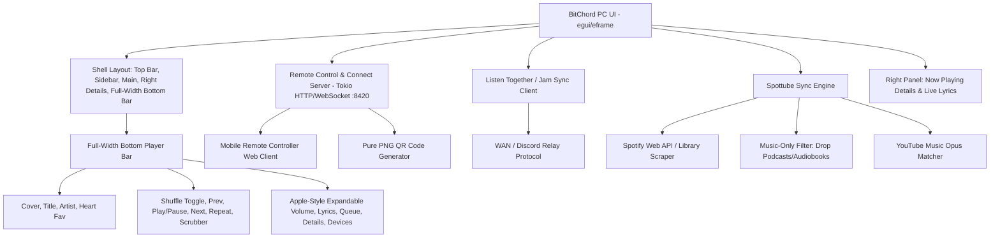

# BitChord PC Complete Overhaul Plan: Mobile Parity & Premium Features

## Executive Summary
This document provides the exhaustive architectural and implementation plan for the **BitChord PC / Windows** application. The overhaul modernizes the desktop client to achieve full design and feature parity with the latest BitChord Mobile release while incorporating the most appreciated features from **Spotify**, **Apple Music**, **Tidal**, **Spicetify**, and **Spottube**.

---

## 1. Architectural Overview & Component Structure

---

## 2. Key Overhaul Modules

### A. Full-Width Bottom Player Bar (Spotify & Apple Music Style)
- **Elimination of Floating Pill**: The old floating pill cramped controls into an awkward centered pill. The new layout pins a full-width bar to the bottom edge (`screen.left()` to `screen.right()`).
- **Three-Zone Partitioning**:
  1. **Left (Track Info)**:
     - Album art thumbnail (rounded corners, subtle border, smooth load).
     - Title with marquee scrolling on overflow, Artist link.
     - Interactive **Heart Button** (replaces old star) with pop animation on like/unlike.
  2. **Center (Playback & Scrubber)**:
     - Spotify-style **Shuffle Toggle**: True boolean toggle with active indicator dot below the icon. Restores original queue order when disabled.
     - Previous / Next buttons with tactile press.
     - Play / Pause button with `scale(0.96)` spring press feedback.
     - Repeat mode toggle (Off -> All -> One).
     - Progress scrubber bar with smooth drag seek and elapsed / remaining timestamps.
  3. **Right (Controls & Apple Volume)**:
     - **Devices / Connect button** (Spotify Connect indicator).
     - **Lyrics toggle** (instant synced karaoke overlay or view).
     - **Queue toggle**.
     - **Now Playing Details toggle** (opens/closes right sidebar).
     - **Apple-Style Volume Slider**:
       - Always visible — no hidden popover.
       - Base height: 5px; smoothly expands to 10px on hover or while dragging.
       - Direct mouse wheel support with delta clamping, completely intercepting scroll events so the main page never scrolls accidentally.
       - Speaker icon acts as mute toggle and reflects mute status.

### B. Navigation & Sidebar Streamlining
- **Removed Duplicate Settings Button**: A click on the user profile avatar in the top bar navigates directly to Settings (`Page::Settings`). The separate sidebar settings button is removed.
- **Top Bar Redesign**:
  - History Navigation: Back (`<`) and Forward (`>`) buttons.
  - **Spicetify Random Song Dice**: Rolling the dice triggers `play_random_song()`, querying trending global tracks and jumping into immediate music discovery.
  - Search pill with autocomplete and quick-clear.
  - Home and Discover navigation pills.
  - Devices Connect modal launcher.
  - User avatar with hover state.

### C. Seamless Remote Control & Listen Together (Jam)
- **Embedded Web & WebSocket Daemon**:
  - Automatically spins up an async Tokio server on port `8420`.
  - Serves a lightweight, touch-optimized web controller (`/`) styled with dark glass and fluid gestures.
  - WebSocket (`/ws`) provides two-way realtime sync for state updates and command execution (Play, Pause, Next, Prev, Seek, Volume, Track metadata, Album art).
- **Device Pairing Modal**:
  - Displays local IP URLs (e.g. `http://192.168.x.x:8420`).
  - Generates authentic PNG QR codes directly in memory (zero text/ASCII art) for instant smartphone scanning.
- **Listen Together / Spotify Jam**:
  - Multi-user synchronized playback session with host/guest tokens.
  - Synchronized track, queue, and playback state across WAN/Discord.
  - **Independent Volume Control**: Each client adjusts their own audio volume locally without impacting the host or other listeners.

### D. Spotify-to-YouTube Music Sync (Spottube Principle)
- **Direct Spotify Library Sync**:
  - Connect Spotify account via user credentials or public playlist links.
  - Direct import and display of Spotify Liked Songs, user playlists, and featured mixes in the library tab.
  - **Strict Content Filtering**: Strips out all episodes, podcasts, and audiobooks.
- **On-the-Fly Audio Matching**:
  - Background async resolver matches Spotify metadata against YouTube Music high-bitrate Opus streams.
  - Instant playback from memory cache with pre-fetching for next tracks in queue.

### E. Now Playing Details Panel (Right Sidebar)
- Resizable right drawer displaying:
  - High-resolution cover artwork.
  - Track title, album name, release year, genre tags.
  - Artist profile card with bio snippet and "Go to Artist" link.
  - "Up Next" queue peek.
  - Synced lyrics preview with auto-scroll highlighting.

---

## 3. Implementation Status & Roadmap

| Module | Status | Verification |
|---|---|---|
| Spotify Podcast/Audiobook Filtering | **Done** | `src/transfer/spotify.rs` parses only music tracks |
| Spotify Library Sync & Playback Actions | **Done** | `src/ui/actions.rs`, `src/ui/pages.rs` |
| Spicetify Dice (Random Song Discovery) | **Done** | `src/ui/playback.rs`, `src/ui/shell.rs` |
| Pure PNG QR Code Generator | **Done** | `src/remote.rs`, `src/ui/devices_dialog.rs` |
| Remote Server (Tokio Web + WS) | **Done** | `src/remote.rs` runs on :8420 |
| Now Playing Details Panel | **Done** | `src/ui/details.rs` |
| Spotify-style Shuffle Toggle & Restore | **Done** | `src/ui/queue.rs` |
| Full-Width Bottom Player Bar | **In Progress** | `src/ui/shell.rs` conversion from floating pill |
| Apple-Style Expandable Volume Slider | **In Progress** | `src/ui/shell.rs` custom painter with hover zoom |
| Sidebar Settings Removal | **In Progress** | `src/ui/shell.rs` cleanup |
| Windows MinGW Cross-Compilation Verification | **In Progress** | Fix compiler linker wrapper |

---

## 4. Verification & Testing Procedure
1. `cargo check --target x86_64-pc-windows-gnu` ensures zero compilation errors.
2. `cargo build --target x86_64-pc-windows-gnu` verifies successful generation of `bitchord.exe`.
3. Test layout resizing, edge-to-edge responsiveness, and volume mouse wheel interaction.
4. Git commit and push to remote.
